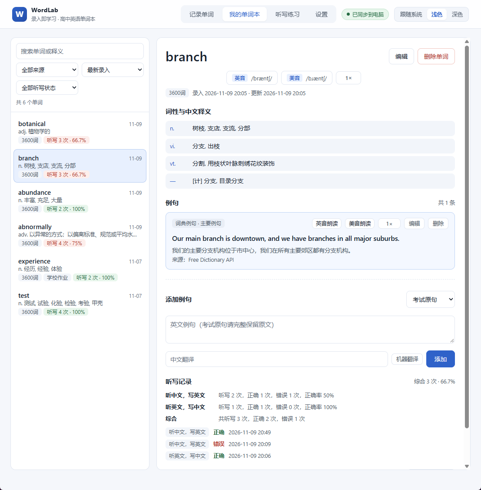
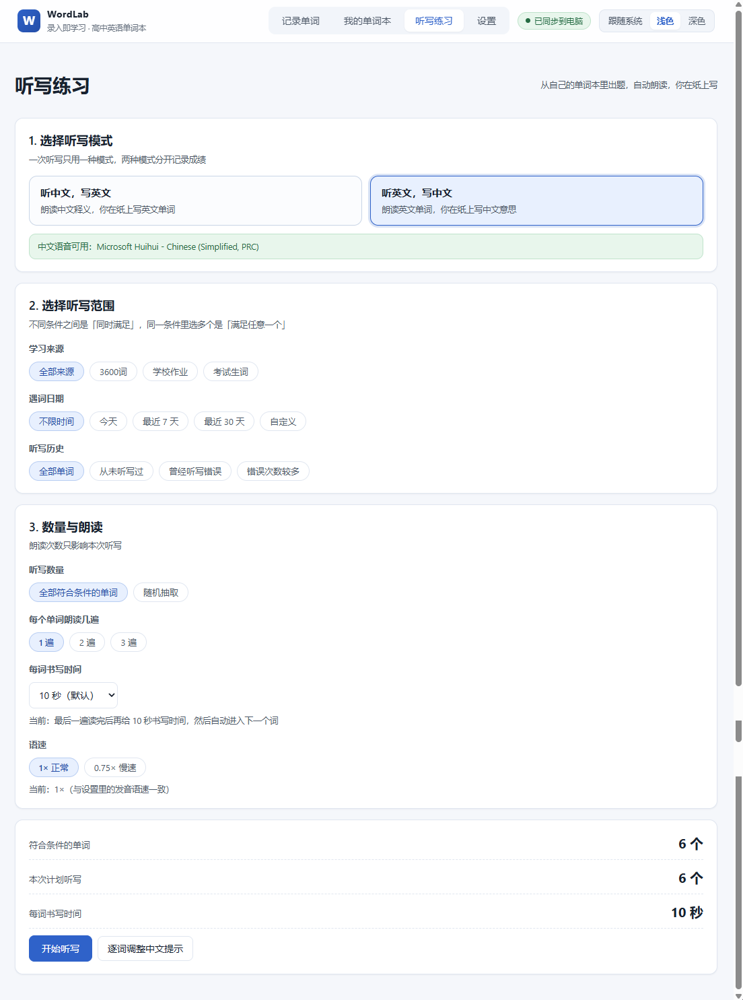

# WordLab

### 给高中生的英语单词记录与听写工具

> 遇到一个单词，就把它记录下来。
>
> 无论是学校作业、3600 词，还是考试和阅读中遇到的生词，都可以整理进自己的单词本。
>
> 不用每天打卡，也不用按照软件安排的顺序背单词。你学到哪里，就记录到哪里。

当前版本：**V1.2**（新增听写练习）

---

## 这是什么

WordLab 是一个装在自己电脑上用的单词本网站。

输入一个英语单词，它会帮你查好音标、词性和中文意思，顺手配上例句。你确认一下、想改就改，点保存，这个词就留在了自己的单词本里。

它不负责"替你安排学习计划"。你从今天的作业、课文、试卷、阅读材料里遇到什么词，就记什么词。时间长了，这个单词本就是你自己真实的词汇地图——哪里见过、见过几次、听写对过几次，都记得清清楚楚。

做完记录，还可以直接拿这些词做听写：网站读，你在纸上写，写完自己对答案。

---

## 主要功能

**📝 记录单词**

输入单词自动查音标、词性和中文释义，配好例句，改完保存。同一个词再次遇到时不会覆盖旧内容，只会多一条"又见到它了"的记录。

**🔊 英美发音**

英音、美音分开播放，可以切成 1× 或 0.75× 慢速。例句也能朗读。

**📖 例句管理**

每个词可以放多条例句，标出主要例句，遇到好句子随时补进去。

**📚 我的单词本**

搜索、按来源筛选、按时间或字母排序。点开一个词，能看到它的全部释义、例句、遇到过几次、听写对错记录。

**🎧 听写练习（V1.2 新增）**

两种模式：

- **听中文，写英文**：先读词性再读中文意思（例如"动词：发展、培养"），你写 develop。
- **听英文，写中文**：读英文单词，你写中文意思。

可以按学习来源、遇到的时间、听写历史来挑词，也可以随机抽几个。每个词能读 1～3 遍，每词写完后的等待时间可以选 5～10 秒。

**📊 听写统计**

每个词听写过几次、对了几次、错了几次、正确率多少，两种模式分开统计。写错的词可以单独再听写一遍。

---

## 界面展示

**记录单词**


**我的单词本**（右边能看到这个词的听写记录）



**听写练习**（选模式、选范围、选朗读遍数和书写时间）



---

## 下载与安装

不需要会编程，跟着做就行。

**第 1 步：下载**

打开 <https://github.com/ybpx/WordLab>，点绿色的 **`Code`** 按钮 → **`Download ZIP`**。

> 如果打开页面看不到代码，说明仓库是私有的，需要先向作者申请访问权限，拿到权限后再下载。

**第 2 步：解压**

把下载的 ZIP 解压到一个**路径里没有特殊符号**的文件夹，比如 `D:\WordLab`。不用解压到 C 盘系统目录里。

**第 3 步：安装 Node.js**

打开 <https://nodejs.org/>，下载 **LTS** 版本，一路"下一步"装完。

装完可以打开命令行输入 `node -v` 看一下版本，需要 **20.19 以上**（20.x 要 ≥ 20.19.0）或 **22.12 以上**。

**第 4 步：双击启动**

在解压出来的文件夹里，双击 **`启动WordLab.bat`**。

- 第一次打开会自己安装、构建，需要联网，大概 1～3 分钟，耐心等它跑完；
- 之后再双击，几秒钟就打开了；
- 浏览器会自动打开 <http://localhost:4173>，就是 WordLab 了。

那个黑色命令行窗口就是网站本体，**用的时候别关**；关掉网站就停了，但数据不会丢。

推荐用 Chrome 或 Edge。不要用无痕窗口，无痕模式里数据存不住。

---

## 基础使用

### 记录第一个单词

1. 打开后默认在「记录单词」页。顶部选一下**学习来源**（比如"学校作业"），没有合适的就点「+ 新增来源」自己加一个。
2. 在输入框里打一个单词，按回车。
3. 等一两秒，音标、词性、中文释义、例句都会自动填好。
4. 哪里不对就点着改，遇到好句子可以补一条例句。
5. 点「保存并录入下一个」。输入框清空，来源保留，可以直接录下一个词。

### 做一次听写

1. 顶部点「听写练习」。
2. 选模式：想练"看中文写英文"就选「听中文，写英文」，想练"看英文写中文"就选另一个。
3. 选范围：来源、遇到的时间、听写历史（比如只挑"曾经写错"的词）。懒得设就都选默认的"全部"。
4. 选朗读遍数（1～3 遍）和每词书写时间（5～10 秒）。
5. 点「开始听写」。先有 3 秒准备时间，然后开始读。
   - 每个词读完最后一遍，才开始倒计时；倒计时结束自动进入下一个词。
   - 没听清点「重听」，不会跳题，这一题还会重新给满书写时间；有事点「暂停」，回来点「继续」接着听。
6. 全部读完后进入核对页：英文和中文都显示出来，默认全算对，**你只需要点那些写错的**。
7. 点「完成批改」→ 确认保存，就能看到这次的正确率。写错的词可以一键"再听写一次"。

中途关掉浏览器也没关系，下次打开会问你要不要继续上次没听完的那次。

---

## 数据保存在哪里

你的单词**只保存在这台电脑上**，不会上传到任何服务器。

- 平时用的时候，浏览器里存一份；
- 同时每次改动都会在电脑的 `文档\WordLab` 文件夹里自动存一份完整备份，每天还会多留一份历史版本；
- 设置页能看到这个文件夹的真实位置，还有一个「打开数据文件夹」的按钮。

**建议**：每周去「设置」页点一次「导出 JSON 完整备份」，存到网盘或 U 盘。换电脑、换浏览器、误删数据的时候，这份备份能救回来。

数据文件夹独立于程序文件夹，删掉程序、重新下载、升级版本，都不会动你的单词。

---

## 这个项目是怎么做出来的

WordLab 是一个通过 **Vibe Coding**（AI 辅助编程）方式开发的个人学习工具。

开发者负责提出需求、设计学习流程、测试和优化使用体验，AI 编程 Agent 协助完成代码实现与版本迭代。

```
Development: Vibe Coding
AI Coding Agent: Coze
```

它不是"AI 帮你背单词"的产品——AI 用在写这个工具的过程里，不是用在你的学习过程里。

---

## 更多文档

| 想了解什么 | 看哪里 |
| --- | --- |
| 每个功能具体怎么操作、遇到问题怎么办 | [学生使用说明](docs/使用说明.md) |
| 代码怎么跑、数据怎么存、怎么改功能 | [开发文档](docs/DEVELOPMENT.md) |

---

## 常见问题

**打不开 / 双击没反应？**
先确认 Node.js 装好了（命令行输入 `node -v` 有版本号）。版本太低会直接提示你，按提示重装 LTS 版即可。

**换电脑了，单词怎么办？**
在旧电脑的「设置」里导出 JSON 完整备份，拷到新电脑，在新电脑的「设置」里导入。

**听中文写英文没有声音？**
这个模式需要电脑里有中文语音。Windows 一般自带。如果提示不可用，可以先用「听英文，写中文」，或者到系统设置里装一个中文语音包再刷新页面。

**能不能手机上用？**
目前是电脑本地运行的版本，只在这台电脑上能访问。
